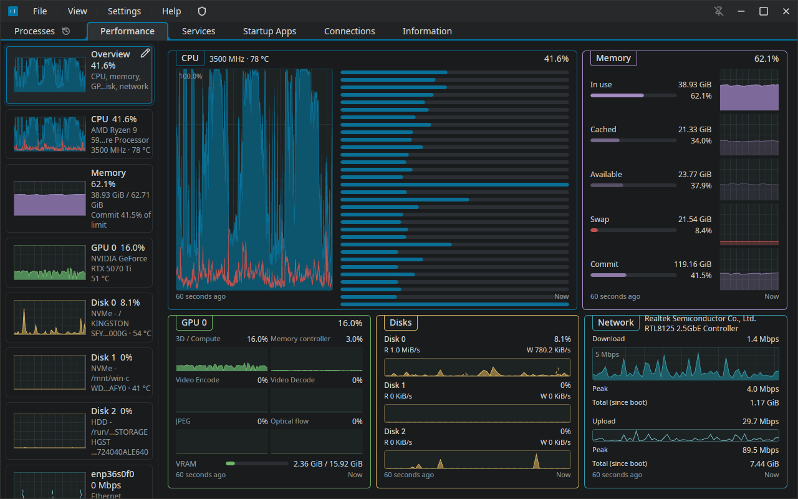

# tasklens

<div align="center">

[](https://github.com/oysteinkrog/tasklens/actions/workflows/ci.yml)
[](LICENSE)

</div>

A task manager for Linux, written in Rust with the GPUI UI framework. It shows processes,
live graphs for every CPU, GPU, disk, network adapter, fan and battery, systemd services,
startup apps and network connections in one window.



**Install on Arch Linux** (there is no binary release yet):

```sh
git clone https://github.com/oysteinkrog/tasklens && cd tasklens/packaging && makepkg -si
```

## TL;DR

**The problem.** On a Linux desktop, the job of one Windows Task Manager is split across
several tools: one for processes, one for performance graphs, `systemctl` for services, and
a terminal for sockets and process priority. The graphical ones that exist leave out process
actions such as priority and CPU affinity, and most show nothing about what happened a few
minutes ago.

**The solution.** tasklens puts all of it in one native window built to draw at 144 Hz, and
it records history so you can look back at what used the CPU or memory.

### Why use tasklens?

| Feature | What it does |
|---|---|
| **Process actions** | End a process or a whole tree, send any signal, set priority, I/O priority and CPU affinity, with `pkexec` for processes you do not own |
| **Process history** | A History mode shows the process table as it was at any point in the last 10 minutes, even with recording turned off |
| **Overview page** | CPU, memory, GPU, disk and network charts on one screen, each box with its own layout (per-core rows, one chart per GPU engine, a CPU power strip) |
| **Device pages** | One page each for every CPU, memory, disk, network adapter, GPU, fan and battery |
| **Services and startup** | systemd system and user units with their journal, plus XDG autostart entries you can turn on and off |
| **Connections** | TCP and UDP sockets, IPv4 and IPv6, with the process that owns each one |
| **Low-memory rescue** | `tasklens-watch` runs as a systemd user service (one switch in Settings) and opens a small rescue window when memory runs out, so you can kill the culprit before the OOM killer picks |
| **Tray graphs** | Tray icons that draw a live CPU, memory, disk, network or GPU graph |

## Quick example

```sh
tasklens                          # open on the last used tab
tasklens --tab performance        # open on the Performance tab
tasklens --select-pid 1234        # open Processes with PID 1234 selected
tasklens --start-minimized        # start hidden in the tray (for autostart)
tasklens --low-memory             # open the low-memory rescue window directly
```

Starting `tasklens` while it is already running brings the open window to the front instead of
starting a second copy.

## Design principles

1. **The UI never waits on the system.** Collectors run on their own runtime in the engine.
   The UI only reads the latest snapshot, so a slow `/proc` read or a hung D-Bus service
   cannot freeze a frame.
2. **Fast drawing comes first.** Every chart and table is drawn on the GPU through GPUI. The
   targets are in the next section, and every change is checked against them with `--bench`.
3. **Collect only what is on screen.** Each collector runs at the rate the visible view needs
   and stops when nothing shows its data.
4. **Risky code runs in its own process.** NVML (the NVIDIA library) runs only in
   `tl-gpu-probe`, and root actions run only in `tl-helper` through `pkexec`. A crash in either
   does not take down the window.
5. **No Tokio.** The engine uses the asupersync runtime, and `cargo xtask check-deps` fails the
   build if Tokio or any crate outside the allowed list gets in.

### Speed targets

| Measure | Target |
|---|---|
| First frame after launch | under 200 ms |
| UI thread CPU per frame, Performance tab with 32 core graphs at 144 Hz | under 2 ms |
| Dropped frames while scrolling a 2,000-row table | none at 144 Hz |
| Collection cost at default rates | under 2% of one core |
| CPU use with the window hidden | under 0.3% of one core |
| Memory | under 150 MB resident |

Not all of these are met yet. See [Limitations](#limitations).

## How tasklens compares

The comparison is with Mission Center 1.2.0, the closest Linux app. The facts come from a
read of its source, recorded in `docs/research/claude-missioncenter-inventory.md`.

| Feature | tasklens | Mission Center 1.2.0 |
|---|---|---|
| UI toolkit | GPUI (GPU, Rust) | GTK 4 and libadwaita |
| Process priority, I/O priority, CPU affinity | Yes | No |
| End process tree | Yes | No |
| Select several processes | Yes | No, one at a time |
| Pick table columns | Yes | No, reorder only |
| Look back at past process use | Yes, 10 minutes, plus optional recording | No |
| Startup apps tab | Yes | No |
| Service journal | Full journal in the unit's Properties | Last 5 messages |
| Overview of all devices on one page | Yes | No |
| Low-memory rescue window | Yes | No |
| Flatpak | No | Yes |
| Tested on many systems | No, one machine | Yes |

**Use tasklens when** you want process control and history in one window on a KDE Plasma
Wayland desktop and do not mind building from source.

**Use Mission Center when** you want a packaged app that is tested on many distributions and
desktops, or you use GNOME.

## Installation

There is no binary release and no crates.io package.

### Arch Linux and Arch-based distributions (makepkg)

`packaging/PKGBUILD` builds a package from the local checkout. It installs the binaries, the
desktop file, the polkit policy and the icon.

```sh
git clone https://github.com/oysteinkrog/tasklens
cd tasklens/packaging
makepkg -si              # add --nocheck to skip the test suite
```

It needs `base-devel`, `clang`, `pkgconf` and `rustup`. rustup picks Rust 1.98.1 from
`rust-toolchain.toml`.

### Any distribution (cargo)

```sh
git clone https://github.com/oysteinkrog/tasklens
cd tasklens
cargo build --release --locked --workspace
./target/release/tasklens
```

This build runs from `target/release/` and finds `tl-gpu-probe` next to it. The root helper
and the setup script are looked up only under `/usr/lib/tasklens/` and need the polkit policy,
so actions on other users' processes and the Additional Setup steps work only from the
installed package.

## Quick start

1. Install it with `makepkg -si` (see above) and start **tasklens** from the app launcher.
2. Open **Performance** (Ctrl+2) and pick **Overview** at the top of the sidebar.
3. Right-click a box title on the Overview to change its layout, or pick **Edit Layout** to
   move and resize boxes.
4. If CPU power draw or fans are missing, click **Additional setup…** in the banner that
   says so and run the steps there. They ask for your password once through `pkexec`.
5. To get the low-memory rescue window, open Settings (Ctrl+,) and turn on **Open rescue
   window on critical memory pressure**. That installs and starts the
   `tasklens-lowmem.service` user unit.
6. Press **Ctrl+?** for the list of keyboard shortcuts.

## Command-line options

```
Usage: tasklens [OPTIONS]

      --start-minimized         Start hidden to the tray, or minimized when the tray is off
      --low-memory              Open the low-memory rescue window
      --watch-memory            Run the low-memory watcher (no window)
      --tab <TAB>               Open on this tab [processes, performance, services, startup,
                                connections, information]
      --select-pid <PID>        Open Processes and select this process
      --debug                   Show the Debug menu
      --app-id <ID>             Run a separate instance with its own settings, state, cache
                                and bus name (development builds)
  -h, --help                    Print help
  -V, --version                 Print version
```

### Keyboard shortcuts

| Keys | Action |
|---|---|
| Ctrl+1 to Ctrl+6 | Go to a tab |
| Ctrl+Tab, Ctrl+Shift+Tab | Next and previous tab |
| Ctrl+F | Focus the filter box |
| Ctrl+N | Run a command |
| Ctrl+, | Settings |
| Ctrl+Plus, Ctrl+Minus, Ctrl+0 | UI scale |
| Ctrl+Shift+M | Performance mini window |
| Ctrl+? | All shortcuts |
| Ctrl+Q | Quit, even with the tray on |
| Ctrl+Esc | Open tasklens from anywhere (KDE global shortcut, turned on in Settings) |

## Configuration

Settings are in `~/.config/tasklens/settings.toml`. The Settings window (Ctrl+,) writes the same
file, so you rarely need to edit it. An excerpt:

```toml
schema_version = 1

[general]
start_tab = "processes"      # tab to open on

[appearance]
ui_scale_pct = 100
heat_coloring = true         # colour busy cells in the process table
heat_intensity_pct = 50

[motion]
animations = true
smooth_graphs = true
save_power_on_battery = true # fewer frames when on battery

[units]
network = "bits"             # or "bytes"

[processes]
interval_ms = 1000           # process table refresh
mode = "grouped"             # group processes by app

[performance]
graph_range_s = 60           # seconds shown in each graph
cpu_graph_mode = "per_core"
cpu_secondary_graph = "power"
```

| Data | Path |
|---|---|
| Settings | `~/.config/tasklens/settings.toml` |
| User themes | `~/.config/tasklens/themes.json` |
| Window and table state | `~/.local/state/tasklens/state.toml` |
| Logs | `~/.local/state/tasklens/logs/` |
| Crash reports | `~/.local/state/tasklens/crash/` |

The paths follow `XDG_CONFIG_HOME` and `XDG_STATE_HOME` when they are set.

## Architecture

```
  /proc  /sys  netlink         D-Bus: systemd, udisks2,          tl-gpu-probe
  (tl-collect parsers)         UPower, NetworkManager, KWin      (only process that loads NVML)
          │                               │                              │
          └───────────────┬───────────────┴──────────────────────────────┘
                          ▼
  ┌─────────────────────────────────────────────────────────────────────┐
  │ tl-engine (asupersync runtime)                                      │
  │   workers sample at the rate the visible view asks for              │
  │   actions go through tl-ops, or tl-helper via pkexec for root       │
  │   history written by tl-history                                     │
  └─────────────────────────────────────────────────────────────────────┘
                          │  latest snapshot, read without blocking
                          ▼
  ┌─────────────────────────────────────────────────────────────────────┐
  │ tl-ui (GPUI): tabs, charts, process table, themes                   │
  └─────────────────────────────────────────────────────────────────────┘
          │                         │                        │
       tasklens (tl-app)      tray icons (tl-tray)   tasklens-watch (tl-watch)
```

| Crate | Role |
|---|---|
| `tl-model` | Data types shared by every other crate |
| `tl-collect` | Parsers for `/proc`, `/sys` and netlink |
| `tl-ops` | Process operations: signals, priority, affinity, I/O priority |
| `tl-engine` | Workers, sampling schedule, D-Bus adapters, actions |
| `tl-history` | Storage format for metric history |
| `tl-gpu-probe` | The only process that loads NVML |
| `tl-ui` | GPUI views, charts, the process table, themes |
| `tl-app` | The `tasklens` binary: startup, settings, logging |
| `tl-helper` | Root helper started through `pkexec` |
| `tl-tray` | Tray icons and their graphs |
| `tl-watch` | The `tasklens-watch` low-memory watcher |

`docs/ARCHITECTURE.md` has the design records (ADR-001 to ADR-017), `docs/DECISIONS.md` the
owner decisions, `docs/ui/` the UI specs and `docs/spec/` the feature specs.

## Troubleshooting

### No CPU power draw

The Intel RAPL energy counters are readable only by root by default. Click **Additional setup…** in
the banner and run the RAPL step. It installs a udev rule through `pkexec`.

### No fan pages, or fans show no RPM

The board's fan chip has no kernel driver loaded yet. Run the `sensors-detect` step in
**Additional setup…**, then reboot or load the module it names.

### No NVIDIA GPU page

tasklens reads NVIDIA GPUs through NVML, which comes with `nvidia-utils`. Check that
`nvidia-smi` works. If it does, look in `~/.local/state/tasklens/logs/` for `tl-gpu-probe`
errors.

### "Permission denied" when ending another user's process

That action needs `tl-helper` and the polkit policy, which only the installed package has.
Install with `makepkg -si` rather than running from `target/release/`.

### The window does not open

GPUI draws through Vulkan. Check that `vulkaninfo --summary` lists your GPU, and read the newest
file in `~/.local/state/tasklens/logs/`.

## Limitations

- **Tested on one machine.** CachyOS, KDE Plasma 6 on Wayland, an NVIDIA GPU and three
  monitors. X11 is best effort. AMD and Intel GPUs are read from sysfs and DRM fdinfo but not
  tested on real hardware.
- **x86_64 Linux only.**
- **Speed targets not all met yet.** Open bugs in `.beads/` record UI thread CPU of about 9 ms
  per frame in moving scenes (target 2 ms), and resident memory of about 155 MB (target 150 MB).
- **No binary packages.** You build it yourself.
- **Window position is not saved**, because Wayland does not allow it. Size and maximized
  state are.
- **Per-process power is an estimate.** Linux has no per-process power source, so the column is
  off by default.
- **Per-process network rates count TCP only.** UDP traffic is not attributed to processes.
- **Package owner in process Properties uses `pacman`**, so it works on Arch-based systems
  only.

## FAQ

### Does tasklens need root?

No. It runs as your user. Root is needed only for actions on other users' processes and for the
one-time setup steps, and those ask through `pkexec` each time.

### Does it send any data over the network?

Only when you click **Fetch** next to Public IP on the Information tab. That asks
`api.ipify.org` (and `api6.ipify.org` for IPv6) and shows a notice first. Nothing else leaves
the machine.

### Does it work on GNOME, or on X11?

It should start, but it is not tested there. The window list uses KWin, so that feature is
missing on other desktops. Native Wayland is the supported path.

### Why GPUI and not GTK or Qt?

GPUI draws everything on the GPU, which is what the 144 Hz target with dozens of live charts
needs. The reasoning is in `docs/ARCHITECTURE.md`.

### How is it developed?

Most of the code is written by AI coding agents (Claude and Codex) working from beads in
`.beads/`, managed with the `br` tool. Each bead names its spec in `docs/`. The owner writes and
approves the specs and decides held work. `AGENTS.md` has the rules for commits, builds and
tests.

```sh
cargo test --workspace
cargo xtask check-deps    # fails if Tokio or a crate outside the allowed list gets in
```

## About Contributions

I don't merge outside pull requests. tasklens is a personal tool, and I don't have the time to
review other people's code for it. Issues and bug reports are welcome. You can also open a pull
request to show a proposed fix, but I won't merge it directly: an agent reviews it with `gh`,
and I decide whether and how to make the change myself.

## License

MIT. See [LICENSE](LICENSE).
